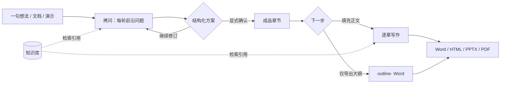

# ThinkForge

**把一句模糊的想法，打磨成一份可交付的成品。**


ThinkForge 是一个运行在 Windows 单机上的 AI 阅读与内容创作工作台。

大多数 AI 写作工具从一句话直接跳到成品；ThinkForge 把中间那一步——**把需求问清楚**——做成可检查、可修改、可复现的流程：拷问式对话收敛需求 → 结构化方案 → 显式确认 → 逐章写作 → Word / HTML / PPT / PDF。

任务、对话、方案与章节落本地 SQLite，成品与原始资料落 `data/`。密钥存 Windows 凭据管理器，不写数据库。

> 唯一的外发通道是模型与嵌入调用：提示词和待索引文本会发送给所配置的服务商。除此之外不联网。

## 核心能力

| 阶段 | 能做什么 | 关键约束 |
| --- | --- | --- |
| 拷问与方案 | 每轮只问「现在就能问」的前沿问题，每题附推荐答案；可继续追问、对话式修订 | 方案必须显式确认；未处置的待确认事项会拦住确认与生成 |
| 资料分析 | 上传 TXT / MD / DOCX / PDF / PPTX 或贴公开网页 URL，先解析再总结 | 总结 ≤ 500 汉字；扫描件无文本层直接说明；URL 抓取做 SSRF 校验 |
| 知识库与引用 | 资料入库后，在拷问与填充时检索命中片段；引用默认全选、逐条可取消 | 嵌入不可用降级关键词检索；双失败明示「本次未使用知识库」 |
| 填充正文 | 按成品章节逐章扩写；可中断、续写、单章重写 | 300–20000 字；各章分摊之和恒等于目标；±15% 偏差只对最短章重试一次 |
| 成品生成 | Word、单文件 HTML 演示、截图版 PPTX、PDF | PPTX 为图片型、文字不可编辑；页数 3–60 是硬约束 |
| 任务管理 | 状态自动保存、重启续作、软删除与回收站 | 删除前先展示影响范围；已删除任务不出现在创作页 |

## 工作流



1. 用一句话、一段描述、一份文档或 PPT 发起任务。
2. 答完每一轮问题；拿不准的题可以「暂时跳过」，它会进入待确认事项。
3. 收敛后检查方案，直接修订或确认。
4. 选「填充为正文」逐章写，或「仅导出大纲」先拿文件。
5. 在生成面板选格式、模板与主题，下载成品。

## 快速开始

### 环境

| 依赖 | 要求 |
| --- | --- |
| 操作系统 | Windows 10 / 11 |
| Python | 3.12+ |
| Node.js | 20+（仅构建前端需要） |
| 模型服务 | 任意 OpenAI 兼容服务；默认 DeepSeek，嵌入默认百炼 `text-embedding-v4` |

### 安装

```powershell
git clone https://github.com/qwertyuio196875/AI-Think-Forge.git
cd AI-Think-Forge

python -m venv backend\.venv
backend\.venv\Scripts\python.exe -m pip install `
  fastapi "uvicorn[standard]" pydantic httpx keyring langgraph `
  python-docx charset-normalizer markdown-it-py pypdf python-pptx `
  python-multipart trafilatura numpy playwright pytest ruff

cd frontend
npm install
npm run build
cd ..
```

截图版 PPT / PDF 还需要内置 Chromium（约 150 MB，只需一次）：

```powershell
backend\.venv\Scripts\python.exe -m playwright install chromium
```

> 依赖的唯一来源是根目录 `pyproject.toml`；上面的命令与它保持一致，不另设 `requirements.txt`。

### 启动

双击 `启动.bat`。它会启动后端并托管已构建的前端，自动打开 <http://127.0.0.1:8720>。

开发时可分开跑：

```powershell
# 终端 1：后端
cd backend
.venv\Scripts\python.exe -m uvicorn app.main:app --host 127.0.0.1 --port 8720

# 终端 2：前端（http://localhost:5173，直连 8720 的 API）
cd frontend
npm run dev
```

### 配置模型

打开「设置」，填写服务商的 API Key，点「连接测试」。密钥只写入 Windows 凭据管理器；连接测试会区分鉴权失败、限流、网络错误等情形，不会把失败伪装成成功。

## 技术栈

| 层 | 选型 |
| --- | --- |
| 后端 | Python 3.12 · FastAPI · Pydantic v2 · SQLite |
| Agent | LangGraph 显式状态机，节点级持久化，重启可恢复 |
| 模型接入 | OpenAI 兼容客户端（`httpx` 直连，不绑定厂商 SDK） |
| 前端 | Vue 3 · TypeScript · Vite · Element Plus |
| 成品 | python-docx · 单文件 HTML · Playwright + python-pptx · PDF |
| 检索 | 向量存 SQLite，numpy 暴力余弦；嵌入不可用时降级关键词检索 |

## 项目结构

```text
backend/
  app/
    api/          # HTTP 路由与依赖注入
    grilling/     # 拷问状态机：前沿问题、收敛、方案修订
    analysis/     # 单份资料的解析、分块、map-reduce 总结
    fill/         # 逐章填充：字数分摊、偏差、分段、引用
    sections/     # 成品章节切分与只读章节表
    pageplan/     # 页面规划：章节 → 页
    retrieval/    # 知识库索引、向量检索与关键词降级
    generation/   # Word / HTML deck / 截图版 PPTX / PDF
    providers/    # 模型配置、凭据、连接测试
    db/ · models/ · security/
  tests/          # 666 项，进程内 HTTP + fake 注入
frontend/
  src/{views,components,api,utils}
  tests/          # 170 项纯函数测试
docs/
  adr/            # 架构决策记录 0001–0006
  agents/         # issue 跟踪、分诊标签、领域文档约定
fixtures/         # 中文语料夹具
data/             # 运行时数据（gitignored）
templates/        # 用户模板（gitignored）
启动.bat
```

## 核心 API

完整接口见运行后的 Swagger：<http://127.0.0.1:8720/docs>（共 52 条路径）。

| 方法 | 路径 | 用途 |
| --- | --- | --- |
| POST | `/api/grilling/tasks` | 发起任务与第一轮拷问 |
| POST | `/api/grilling/tasks/{id}/answers` | 提交本轮回答与取消的引用 |
| POST | `/api/grilling/tasks/{id}/plan/confirm` | 确认方案（生成闸门） |
| POST | `/api/tasks/{id}/fill/run` | 逐章填充正文 |
| POST | `/api/tasks/{id}/sections/{seq}/rewrite` | 单章重写 |
| POST | `/api/tasks/{id}/page-plans` | 创建页面规划 |
| POST | `/api/tasks/{id}/generations` | 生成 Word / HTML / PPTX / PDF |
| GET | `/api/knowledge/sources` | 知识库清单 |

## 测试

```powershell
# 后端（仓库根）
backend\.venv\Scripts\python.exe -m pytest
backend\.venv\Scripts\python.exe -m ruff check .

# 前端
cd frontend
npm run test:unit
npm run type-check
npm run build
```

- 后端 666 项、前端 170 项；`ruff` 全绿，`vue-tsc` 零错误。
- 测试接缝在 HTTP API 边界：进程内客户端驱动，不起真实端口、不联网、不启动浏览器。
- 模型、URL 抓取、嵌入、页面渲染器都是可注入的 fake；测试零真实花费。
- 不对模型输出的语义质量做自动断言——语义由人看证据链验收。

## 安全与边界

- 只监听 `127.0.0.1`，同网段其他设备无法访问；CORS 仅放行本机开发端口。
- 上传限制文件类型与大小（默认 50 MB），落盘路径不越出 `data/` 白名单。
- URL 抓取只允许 http/https，双阶段拦截环回、私网、链路本地与云元数据地址；最多 3 跳、15 s 超时、5 MB 上限。
- 密钥只进 Windows 凭据管理器；SQLite、日志、前端都不出现明文 Key。
- 不做 OCR：扫描件与纯图片会明确返回 `no_text_layer`，不猜内容。
- PPTX 是「一页一张截图」的图片型成品，文字不可编辑、不可检索；需要可编辑 PPT 时选 Word 或 HTML。
- 首次使用真实 Key 前，建议先跑一次设置页的「连接测试」。

## 文档与决策

- [GLOSSARY.md](GLOSSARY.md)：领域术语表（权威口径）。
- [docs/adr/](docs/adr/)：架构决策记录 0001–0006，含被取代的旧结论与原因。
- [docs/agents/](docs/agents/)：issue 跟踪、分诊标签与领域文档约定。
- [.scratch/workbench-v1/issues/08-v1-unified-spec.md](.scratch/workbench-v1/issues/08-v1-unified-spec.md)：v1 统一规格。
- [.scratch/workbench-v1/spec.md](.scratch/workbench-v1/spec.md)：产品与技术方案。

## 路线图

- **v1.0**：拷问闭环、资料分析、Word 与单文件 HTML、历史与续作。
- **v1.1（当前）**：填充正文与字数控制、页面规划与截图版 PPTX / PDF、知识库与最小版 RAG。
- **下一步**：PPTX 填用户模板 → 文档型 HTML → 方案直接编辑 → 可执行打包 → 模板版本管理。

## 许可证

本仓库目前**未声明开源许可证**。public 仓库仅表示可公开访问，不构成复制、分发或商用授权；如需对外使用，请先补充 `LICENSE`。